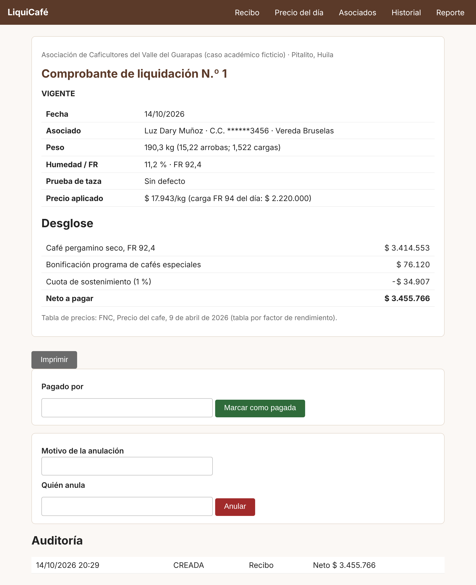
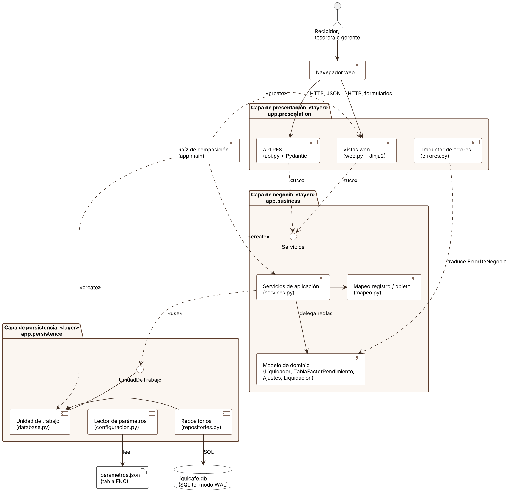
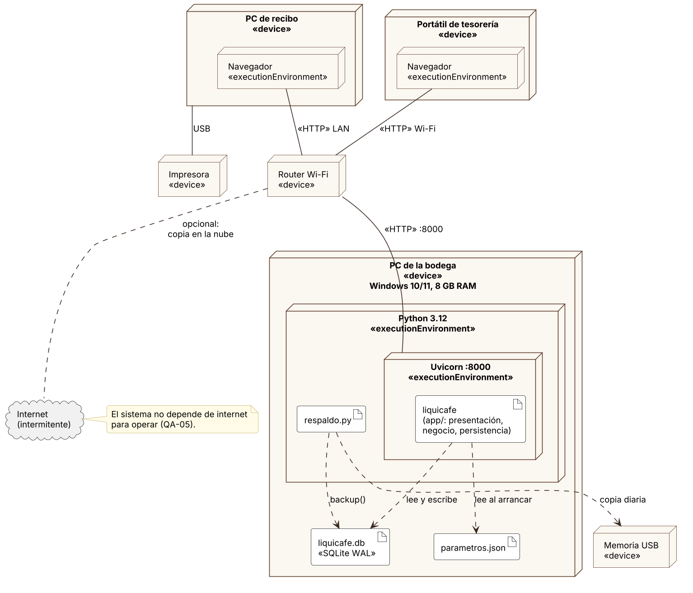

# LiquiCafé

Sistema de liquidación de compras de café pergamino seco para una asociación de caficultores de Pitalito, Huila. Es un MVP construido con el **patrón arquitectónico en capas** para la *Actividad de Aprendizaje 3: Exploración y Aplicación de Patrones Arquitectónicos Clásicos* (Diseño y Patrones Arquitectónicos, CORHUILA).

> La asociación es un caso académico ficticio. Los precios, la tabla de factor de rendimiento y las normas citadas son reales: el sistema se prueba contra el boletín de la Federación Nacional de Cafeteros (FNC) del 9 de abril de 2026.



## Qué problema resuelve

Hoy el recibidor de la bodega liquida con calculadora y cuaderno, y en la noche alguien pasa todo a Excel. LiquiCafé registra cada entrega y la liquida según las reglas de la FNC:

- precio por factor de rendimiento (FR) con la pasilla valorada aparte;
- descuentos por taza, bonificación por programa especial y cuota de sostenimiento;
- un comprobante con desglose y la cédula enmascarada.

Las liquidaciones no se borran: se anulan con motivo y quedan en la auditoría.

Un hallazgo guió el diseño. Ajustar el precio de forma proporcional (`precio × 94 / FR`) se aleja hasta un **2,86 %** de la tabla oficial, porque la FNC paga aparte la pasilla. El modelo correcto vive en `app/business/domain/tabla_fr.py`.

## Arquitectura

Tres capas lógicas **cerradas**, desplegadas en dos niveles físicos: un servidor en el PC de la bodega y navegadores en la red local.

| Capa | Paquete | Responsabilidad | Puede importar |
|---|---|---|---|
| Presentación | `app.presentation` | HTTP, vistas Jinja2, API JSON, formato de entrada | solo `app.business` |
| Negocio | `app.business` | Casos de uso (`services.py`), mapeo y **dominio puro** (`domain/`) | solo `app.persistence` |
| Persistencia | `app.persistence` | SQLite, unidad de trabajo, repositorios que devuelven `dict` | nada del proyecto |

`app/main.py` es la **raíz de composición**: el único módulo que conoce las tres capas y las conecta.

**El patrón se verifica, no solo se dibuja.** `pyproject.toml` define tres contratos de [import-linter](https://import-linter.readthedocs.io/):

1. ninguna capa importa a una superior;
2. la presentación no salta directo a la persistencia;
3. el dominio no conoce ni los servicios, ni la persistencia, ni FastAPI.

`tests/architecture/test_capas.py` los ejecuta junto con el resto de las pruebas.

### Diagramas UML

Los fuentes en PlantUML están en [`docs/diagramas/`](docs/diagramas). La explicación técnica de cada uno está en [`docs/02-diseno.md`](docs/02-diseno.md).

| Componentes | Despliegue |
|---|---|
|  |  |

- [Diagrama de clases](docs/diagramas/02-clases.png)
- [Diagrama de secuencia: registrar entrega y liquidar](docs/diagramas/03-secuencia.png)

Más documentación:

- [Diagnóstico, requisitos y escenarios de calidad](docs/01-diagnostico.md)
- [Registro de decisiones](docs/03-decisiones.md)

## Requisitos

- Python 3.12 o superior
- Git
- Para regenerar los diagramas (opcional): Java 11+ y `plantuml.jar`

## Instalación

```bash
git clone https://github.com/VictorAndres123/liquicafe.git
cd liquicafe
python -m venv .venv
# Windows: .venv\Scripts\activate    Linux/macOS: source .venv/bin/activate
pip install -r requirements-dev.txt
```

## Ejecución

```bash
python -m scripts.datos_demo          # precio de hoy y tres asociados de prueba
uvicorn app.main:crear_app --factory --host 0.0.0.0 --port 8000
```

| Para qué | Dirección |
|---|---|
| Vistas de la bodega | <http://localhost:8000/recibo> |
| API documentada (Swagger) | <http://localhost:8000/docs> |

Para probar un recibo, escribe la cédula `1075123456`, 190,3 kg, humedad 11,2 y FR 92,4.

Con `--host 0.0.0.0` los otros equipos de la red local entran con la IP del PC de la bodega. El router **no** debe exponer el puerto a internet.

### Variables de entorno

| Variable | Valor por defecto | Uso |
|---|---|---|
| `LIQUICAFE_DB` | `datos/liquicafe.db` | Archivo SQLite (ignorado por Git: contiene datos personales) |
| `LIQUICAFE_PARAMETROS` | `config/parametros.json` | Tabla FNC, rangos de humedad, bonificación y cuota |

### Respaldo diario

```bash
python scripts/respaldo.py --origen datos/liquicafe.db --destino E:/respaldos
```

Usa la API de backup de SQLite, así que la copia sale consistente aunque el sistema esté en uso. Guarda los últimos 30 respaldos.

## Pruebas

```bash
pytest --cov=app        # 70 pruebas, cobertura ≈ 97 %
lint-imports            # 3 contratos de arquitectura
```

| Tipo | Carpeta | Qué cubre |
|---|---|---|
| Unitarias | `tests/unit` | Las reglas del dominio sin base de datos. El oráculo es la tabla FNC del 9 de abril de 2026 (13 valores de FR) |
| Integración | `tests/integration` | Servicios contra SQLite real: rollback ante fallos, triggers que impiden borrar y respaldo |
| De punta a punta | `tests/api` | API y vistas con `TestClient`: cédula enmascarada y coma decimal |
| Arquitectura | `tests/architecture` | Contratos de capas |

Una nota sobre la tolerancia: las pruebas aceptan 1 peso por kilo de diferencia con la tabla de la FNC. No existe un precio del excelso que reproduzca las 13 filas a la vez, porque la FNC redondea con datos que no publica. El detalle está en `docs/03-decisiones.md` (D-04).

## Estructura

```
liquicafe/
├── app/
│   ├── main.py                  # raíz de composición
│   ├── presentation/            # capa 1: HTTP
│   │   ├── web.py               #   controladores de las vistas HTML
│   │   ├── api.py               #   API REST
│   │   ├── schemas.py           #   validación de formato (Pydantic)
│   │   ├── errores.py           #   ErrorDeNegocio -> 404 / 409 / 422
│   │   └── templates/           #   vistas Jinja2
│   ├── business/                # capa 2: negocio
│   │   ├── services.py          #   casos de uso y límites de transacción
│   │   ├── mapeo.py             #   dict <-> objetos de dominio
│   │   └── domain/              #   reglas puras: Liquidador, TablaFactorRendimiento, Ajustes
│   └── persistence/             # capa 3: datos
│       ├── database.py          #   esquema, triggers, UnidadDeTrabajo
│       ├── repositories.py      #   SQL por tabla
│       └── configuracion.py     #   lectura de parametros.json
├── config/parametros.json       # tabla FNC y reglas configurables
├── scripts/                     # respaldo y datos de demostración
├── tests/                       # unit, integration, api, architecture
├── docs/                        # diagnóstico, diseño, decisiones, diagramas, capturas
└── .github/workflows/ci.yml     # contratos + pruebas en cada push
```

## Alcance del MVP

Incluye RF-01 a RF-10: asociados con autorización de datos, precio del día, recibo y liquidación, comprobante, historial, rechazos, anulación, pago y reporte diario.

Queda por fuera, a propósito:

- **Autenticación y roles.** Mitigado porque el servidor solo atiende la red local. Es la primera mejora.
- **Consulta automática del precio de la FNC.**
- **Documento soporte electrónico de la DIAN** (Resolución 000167 de 2021).

## Autor

**Victor Rojas**, estudiante de Ingeniería de Sistemas, Corporación Universitaria del Huila (CORHUILA).
Curso: Diseño y Patrones Arquitectónicos. Docente: Jesús Ariel González Bonilla. Octubre de 2026.
