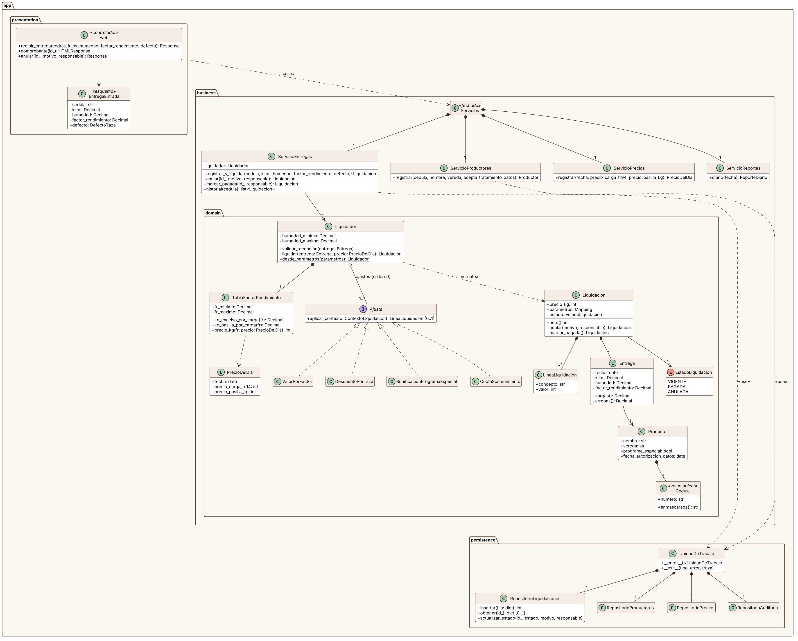
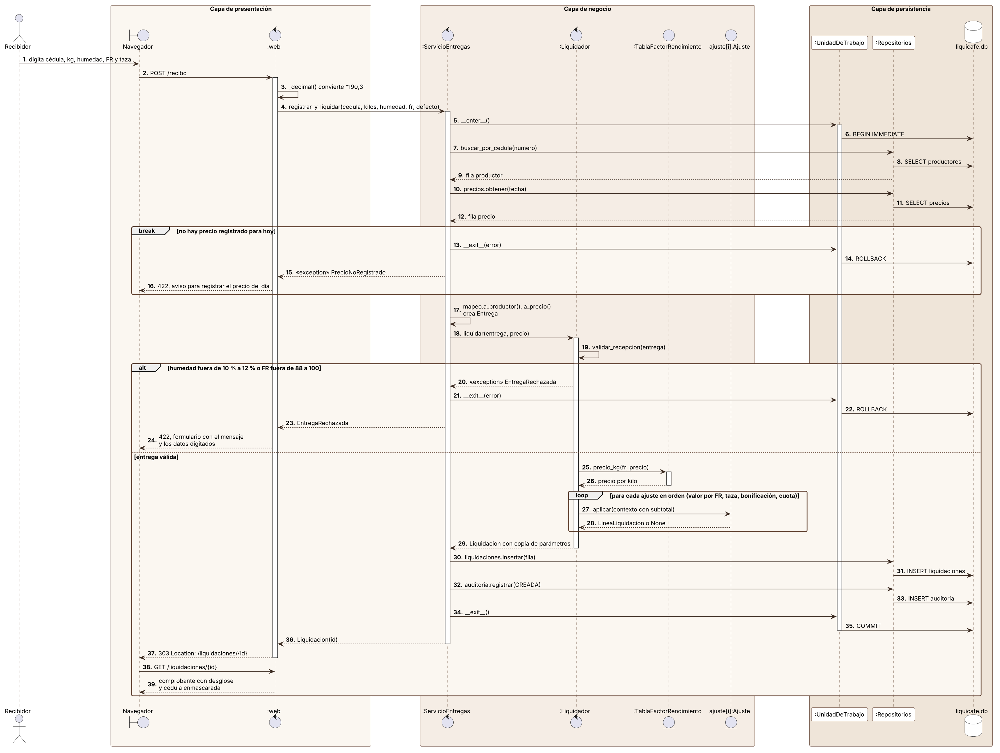

# Diseño arquitectónico de LiquiCafé

Los cuatro diagramas están escritos en PlantUML (`docs/diagramas/*.puml`) y se
exportan a PNG y SVG. Para regenerarlos:

```bash
java -jar plantuml.jar -tpng -Sdpi=150 docs/diagramas/0*.puml
```

Usé PlantUML y no Mermaid porque Mermaid no tiene diagramas UML de componentes
ni de despliegue con la notación del estándar.

## 1. Diagrama de componentes


El diagrama muestra el patrón en su forma más directa: tres paquetes con el
estereotipo `«layer»` apilados de arriba hacia abajo, y todas las dependencias
apuntando hacia abajo.

- **Presentación** tiene tres componentes. Las *vistas web* atienden los
  formularios de la bodega; la *API REST* atiende JSON y se documenta sola en
  `/docs`; el *traductor de errores* convierte cada `ErrorDeNegocio` en 404, 409
  o 422. Las vistas y la API **requieren** la interfaz `Servicios`
  (dependencia `«use»`), pero no conocen su implementación.
- **Negocio** **provee** la interfaz `Servicios` (notación de lollipop). Los
  servicios de aplicación delegan las reglas al *modelo de dominio* y usan el
  *mapeo* para convertir registros en objetos.
- **Persistencia** provee la interfaz `UnidadDeTrabajo`, que agrupa por
  composición a los *repositorios*. Es la única capa que habla SQL con
  `liquicafe.db`, y también lee `parametros.json`.
- La **raíz de composición** (`app.main`) queda fuera de las capas. Es el
  único componente que las conoce a las tres, porque su trabajo es crearlas y
  conectarlas (`«create»`).

Las capas son **cerradas**: la presentación nunca llama a la persistencia
directamente. Esto no es solo una intención del diagrama. Tres contratos de
import-linter (`pyproject.toml`) lo verifican en cada ejecución de las pruebas.

## 2. Diagrama de clases



Este diagrama baja al nivel de las clases reales del repositorio y muestra
cómo cada capa cumple su papel.

- **Presentación:** `web` (estereotipo `«controlador»`) depende de la fachada
  `Servicios` y de los esquemas de entrada como `EntregaEntrada`.
- **Negocio:** `Servicios` es una fachada compuesta por cuatro servicios de
  aplicación. `ServicioEntregas` tiene una asociación con `Liquidador` y una
  dependencia `«use»` con `UnidadDeTrabajo`, porque abre una transacción por
  cada caso de uso.
- **Dominio:**
  - `Liquidador` se **compone** de una `TablaFactorRendimiento` y **agrega**
    una lista ordenada (`{ordered}`) de objetos que **realizan** la interfaz
    `Ajuste`.
  - Las cuatro reglas de dinero (`ValorPorFactor`, `DescuentoPorTaza`,
    `BonificacionProgramaEspecial` y `CuotaSostenimiento`) son
    implementaciones intercambiables de esa interfaz.
  - Esa es la decisión que hace barato el escenario QA-02: una bonificación
    nueva es una clase más que realiza `Ajuste`.
- **Liquidacion** se compone de una `Entrega` y de una o más
  `LineaLiquidacion`. La entrega apunta a su `Productor`, que se compone de un
  objeto de valor `Cedula`. `Cedula` enmascara el número al convertirse en
  texto, así que la privacidad es el comportamiento por defecto.
- **Persistencia:** `UnidadDeTrabajo` se compone de los cuatro repositorios.
  Los repositorios reciben y devuelven `dict`, no objetos del dominio. Por eso
  no hay ninguna flecha desde `persistence` hacia `business`.

## 3. Diagrama de secuencia: registrar entrega y liquidar



Es el flujo principal del sistema (RF-03 y RF-04). Los participantes están
agrupados en cajas por capa, y los mensajes cruzan las cajas una a una, sin
saltarse ninguna:

1. El recibidor envía el formulario. El controlador `:web` solo convierte el
   formato (`"190,3"` pasa a `Decimal`) y llama a
   `registrar_y_liquidar()`.
2. `:ServicioEntregas` abre la unidad de trabajo (`BEGIN IMMEDIATE`) y lee el
   productor y el precio del día con los repositorios.
3. El fragmento **`break`** cubre el caso en que la gerencia no ha registrado
   el precio de hoy. Se hace `ROLLBACK` y el usuario recibe un 422 con el
   aviso.
4. `:Liquidador` valida la recepción. El fragmento **`alt`** separa la
   entrega rechazada (humedad o FR fuera de rango), que también termina en
   `ROLLBACK`, de la entrega válida.
5. En la rama válida, la tabla calcula el precio por kilo y un **`loop`**
   aplica cada ajuste en orden, pasando el subtotal acumulado. La cuota de
   sostenimiento va de última porque se calcula sobre ese subtotal.
6. La liquidación y su evento de auditoría se insertan dentro de la misma
   transacción y se confirman juntos (`COMMIT`). Si falla cualquiera de los
   dos, no queda nada a medias (QA-05).
7. El controlador responde `303` hacia el comprobante (patrón
   Post/Redirect/Get), así que recargar la página no liquida dos veces la
   misma entrega.

## 4. Diagrama de despliegue


Las cuatro capas lógicas se despliegan en **dos niveles físicos**. Una capa
(*layer*) es una separación lógica del código y un nivel (*tier*) es una
separación física (Fowler, 2002).

- **Nivel servidor: el PC de la bodega (`«device»`).** Ejecuta Python 3.12 y,
  dentro de él, Uvicorn en el puerto 8000. En Uvicorn vive el artefacto
  `liquicafe`, con sus tres capas. En el mismo equipo están `liquicafe.db`
  (SQLite en modo WAL) y `parametros.json`.
- **Nivel cliente:** el PC de recibo y el portátil de tesorería, que solo
  ejecutan un navegador.
- **Comunicación:** todo viaja por HTTP dentro de la red local del router.
- **Internet:** aparece como una conexión opcional, solo para copiar el
  respaldo en la nube. El sistema no depende de internet para operar (QA-05).
- **Respaldo:** `respaldo.py` usa la API de backup de SQLite para copiar la
  base a una memoria USB. Así se mitiga el riesgo de que el PC de la bodega
  sea un punto único de falla.
